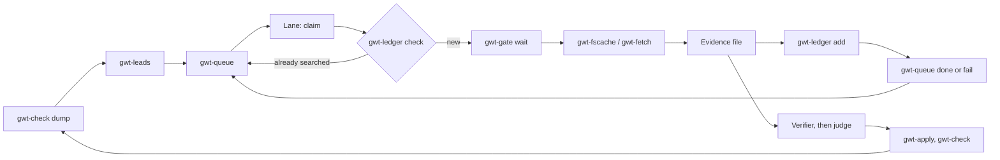

# The autonomous research loop

The [pipeline](pipeline.md) describes who decides what. This page wires the command-line tools into the loop an agent runs on its own: find the gaps, queue them, search without repeating or hammering a site, verify, and hand the findings to the judge. Every step below is a tool in this repo; nothing here writes to the tree.



## One round

1. **Find the gaps.** `gwt-check dump tree.json.gz`, then `gwt-leads --root I0001 --format queue --limit 200 tree.json.gz | sh`. The dump is the file `gwt-check dump` wrote, and `gwt-leads` stops with exit 2 if it is anything else. The queue now holds the lines that stop, the missing vitals and the uncited facts, direct ancestors first. `--dedupe` makes re-running safe. See [gwt-leads](leads.md).
2. **Start the lanes.** Each lane is one agent with its own name. All of them share one queue file, one ledger directory, one gate directory and one cache directory:

   ```bash
   export GWT_QUEUE=work/cola.tsv GWT_LEDGER=work/buscado.tsv GWT_LEDGER_DIR=work/ledger \
          GWT_GATE_DIR=work/gate GWT_FSCACHE_DIR=work/cache GWT_AGENT=lane-2
   ```
3. **Each lane loops** until `claim` exits 1:

   ```bash
   while row=$(gwt-queue claim --lane "$GWT_AGENT"); do
       id=$(cut -f1 <<<"$row"); person=$(cut -f2 <<<"$row"); query=$(cut -f6 <<<"$row")
       source=$(cut -f5 <<<"$row"); token=$(cut -f17 <<<"$row")

       # the best ledger row for this search: score, person, label, source, query, date, RESULT, EVIDENCE, ...
       prior=$(gwt-ledger check --person "$person" --source "$source" --query "$query" | head -1)
       case "$(cut -f7 <<<"$prior")" in
           hit|none|partial|denied)       # a finished search: carry its result and evidence over unchanged
               gwt-queue done --id "$id" --token "$token" --result "$(cut -f7 <<<"$prior")" \
                   --evidence "$(cut -f8 <<<"$prior")" --note "reused the ledger row of $(cut -f6 <<<"$prior")"
               continue ;;
       esac                               # no row, or a `blocked` one: that search never happened, so run it
       gwt-gate wait "$GWT_AGENT" || { gwt-queue release --id "$id" --token "$token"; sleep 600; continue; }
       # ... search through gwt-fscache or gwt-fetch, write ev/$id.txt, set $result to what the search found:
       # hit, none or partial. On a block: gwt-gate hit, gwt-queue fail, and go on to the next task.
       gwt-ledger add --person "$person" --source "$source" --query "$query" --result "$result" --evidence ev/$id.txt
       gwt-queue done --id "$id" --token "$token" --result "$result" --evidence ev/$id.txt
   done
   ```

   A ledger row only saves a search that finished. Its result and evidence go into the task unchanged: a `hit` stays a `hit`, `partial` stays `partial`, and a `blocked` row is not a search at all, so the lane runs it. Nothing here turns a block into an absence.

   The exit code of `gwt-gate wait` is the lane's signal: `3` means a pause is running, so give the task back with `release` and do other work. On a 429, 403 or captcha the lane calls `gwt-gate hit` and `gwt-queue fail`: the task backs off and returns later instead of being lost. A "no result" from a site that was blocking is a `fail`, not a `none`.
4. **Verify and judge.** The evidence files go to the verifier and then the judge exactly as in the [pipeline](pipeline.md). A `hit` creates a `followup` task (`gwt-queue add --kind followup`) for whatever it opens next: the parents named in an act, the parish of a marriage.
5. **Apply and check.** The judge's rulings become a change list; `gwt-apply` writes it and `gwt-check` verifies the result. The next `gwt-check dump` is the next round's input: a gap that was filled no longer shows up in `gwt-leads`.

## What each tool prevents

| Failure | Tool |
|---|---|
| Two lanes search the same thing | `gwt-queue` hands each task to one lane; `gwt-ledger` remembers finished searches |
| A lane dies holding work | `gwt-queue` reopens a claim after `--stale-minutes`; the dead lane's token no longer works |
| A blocked site is hammered | `gwt-gate` gives every lane one pace and pauses all of them on a hit |
| A repeated request spends rate budget | `gwt-fscache` answers it from disk and never stores a block |
| Effort goes to the wrong branch | `gwt-leads` ranks the root's direct ancestors first |
| A transient failure loses a lead | `gwt-queue fail` backs the task off and parks it after `--max-tries` |

## Limits

- The loop finds and ranks leads. It does not decide that a record is the right person. That stays with the verifier and the judge.
- `gwt-leads` only sees what the tree already holds. A branch with no people in it has no gap to report: seed those tasks by hand with `gwt-queue add`.
- Keep the queue, ledger, gate and cache directories on one machine, or on a filesystem with working `flock`.
