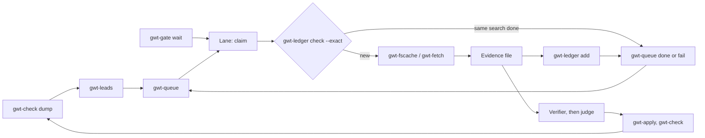

# The autonomous research loop

The [pipeline](pipeline.md) describes who decides what. This page wires the command-line tools into the loop an agent runs on its own: find the gaps, queue them, search without repeating or hammering a site, verify, and hand the findings to the judge. Every step below is a tool in this repo; nothing here writes to the tree.



## One round

1. **Set the shared paths.** Every lane and the seeder use one queue file, one ledger directory and one cache directory. Each lane has its own name and works one site, with that site's own gate directory, so a block on one site does not pause the lanes on another:

   ```bash
   # shared by everyone
   export GWT_QUEUE=work/cola.tsv GWT_LEDGER=work/buscado.tsv GWT_LEDGER_DIR=work/ledger \
          GWT_FSCACHE_DIR=work/cache
   # per lane: its name, its site, and that site's gate (one per rate-limited site or account)
   export GWT_AGENT=lane-2 SRC=familysearch GWT_GATE_DIR=work/gate/familysearch
   mkdir -p work ev
   ```

   Keep `work/` untracked and on one machine: the queue is rewritten whole under a local `flock`.
2. **Find the gaps and seed them.** `gwt-check dump` pages the whole tree, so do not run it while that tree's writer applies a change list. Write the seeds to a file and chain with `&&`, so a bad dump (exit 2) stops the round instead of seeding nothing:

   ```bash
   gwt-check dump work/tree.json.gz &&
   gwt-leads --root I0001 --source "$SRC" --format queue --limit 200 work/tree.json.gz > work/seeds.jsonl &&
   gwt-queue add --jsonl work/seeds.jsonl --dedupe
   ```

   The queue now holds the lines that stop, the missing vitals and the uncited facts, direct ancestors first, one task per person and kind. People who may be living and private records are held back, their ids on stderr. `--dedupe` skips a task already queued, running or done, so a re-seed adds only new gaps and refreshes the notes of open tasks. See [gwt-leads](leads.md) and [gwt-queue](queue.md).
3. **Each lane loops** until nothing is due:

   ```bash
   set -o pipefail
   while :; do
       gwt-gate wait "$GWT_AGENT"; rc=$?
       if [ "$rc" -eq 3 ]; then sleep 300; continue; fi    # the site is paused: wait without holding a task
       [ "$rc" -eq 0 ] || { echo "gwt-gate exit $rc" >&2; break; }
       row=$(gwt-queue claim --lane "$GWT_AGENT" --source "$SRC") || break   # 1: nothing is due
       id=$(cut -f1 <<<"$row"); person=$(cut -f2 <<<"$row"); kind=$(cut -f4 <<<"$row")
       source=$(cut -f5 <<<"$row"); query=$(cut -f6 <<<"$row"); token=$(cut -f17 <<<"$row")
       lsrc=${source:-any}; [ "$kind" = search ] || lsrc="$lsrc-$kind"   # a verify is not a search

       # reuse a finished search only on an exact match: same source, identical query, newest row first
       prior=$(gwt-ledger check --exact --person "$person" --source="$lsrc" --query "$query"); rc=$?
       if [ "$rc" -gt 1 ]; then
           gwt-queue release --id "$id" --token "$token"; echo "gwt-ledger exit $rc" >&2; break
       fi
       if [ "$rc" -eq 0 ]; then
           # score, person, label, source, query, date, RESULT, EVIDENCE, agent, NEXT_DATE
           top=$(head -1 <<<"$prior"); result=$(cut -f7 <<<"$top"); next=$(cut -f10 <<<"$top")
           if [ "$result" != blocked ] && { [ -z "$next" ] || [[ "$next" > "$(date +%F)" ]]; }; then
               gwt-queue done --id "$id" --token "$token" --result "$result" \
                   --evidence "$(cut -f8 <<<"$top")" --note "reused the ledger row of $(cut -f6 <<<"$top")"
               continue
           fi
       fi
       # ... search through gwt-fscache or gwt-fetch, write ev/$id.txt, set $result to hit, none or partial.
       # On a long task, call `gwt-queue renew --id "$id" --token "$token"` before the lease runs out.
       # On a block, see below, then `continue`.
       gwt-ledger add --person "$person" --source="$lsrc" --query "$query" \
           --result "$result" --evidence "ev/$id.txt" || break
       gwt-queue done --id "$id" --token "$token" --result "$result" --evidence "ev/$id.txt"
   done
   ```

   The gate comes before the claim. A lane that finds the site paused sleeps without holding a task, so a long pause costs no tries. Exit 3 is the only pause; any other non-zero exit from `gwt-gate wait` is an error and stops the lane, and so does an error from `gwt-ledger` (exit 2). Exit 1 from `check` is a plain miss.

   The ledger has no task-kind column, so the loop gives each kind its own ledger source: `familysearch` for a search, `familysearch-verify`, `familysearch-sweep` and `familysearch-followup` for the others, and `any` in place of an empty source. Without that, a `verify` task would share the row of a `search` task on the same person, source and query, and close with a result nobody checked. The suffixes are reserved in [gwt-ledger](ledger.md). Pass the value as `--source="$lsrc"`, with the `=`, so it can never be read as a flag.

   A ledger row stands in for a search only when it is an exact match (`check --exact`: same source, identical normalized query), its result is not `blocked`, and its `next_date`, if any, is still in the future. `check` lists equal rows newest first, so a later `hit` wins over an older `none`. A fuzzy match is a hint for a person, never a result for a script: the search runs. A reused row's result and evidence go into the task unchanged. Nothing here turns a block into an absence.

   **On a block** (a 429, a 403, a captcha): `gwt-gate hit "$GWT_AGENT" "<what>"` pauses every lane on that site; log the try with `gwt-ledger add ... --result blocked`, which no check ever reuses; then `gwt-queue fail`, so the task backs off and returns later. For an IP or account block that lasts hours, `gwt-gate block <hours> "<why>"` stops every lane on that gate for that long. On a 401, `gwt-gate dead` exits 4: the session is gone, so stop the lane. A "no result" from a site that was blocking is a `fail`, not a `none`. `gwt-queue release` is only for an attempt where nothing ran.
4. **Verify and judge.** The evidence files go to the verifier and then the judge exactly as in the [pipeline](pipeline.md). A `hit` creates a `followup` task (`gwt-queue add --kind followup`) for whatever it opens next: the parents named in an act, the parish of a marriage.
5. **Apply and check.** The judge's rulings become a change list; `gwt-apply` writes it and `gwt-check` verifies the result. The next `gwt-check dump` is the next round's input: a gap that was filled no longer shows up in `gwt-leads`. A gap whose search came back `none` still shows up, and `--dedupe` keeps it from being queued again.

## What each tool prevents

| Failure | Tool |
|---|---|
| Two lanes search the same thing | `gwt-queue` hands each task to one lane; `gwt-ledger` remembers finished searches |
| A lane dies holding work | `gwt-queue` reopens a claim when its lease runs out; the dead lane's token no longer works |
| A blocked site is hammered | `gwt-gate` gives every lane on a site one pace and pauses all of them on a hit |
| A finished search is queued again | `gwt-queue add --dedupe` also matches done tasks; `gwt-ledger check --exact` stands in for a search only on an identical one |
| A repeated request spends rate budget | `gwt-fscache` answers it from disk and never stores a block |
| Effort goes to the wrong branch | `gwt-leads` ranks the root's direct ancestors first |
| A transient failure loses a lead | `gwt-queue fail` backs the task off and parks it after `--max-tries` attempts |

## Limits

- The loop finds and ranks leads. It does not decide that a record is the right person. That stays with the verifier and the judge.
- `gwt-leads` only sees what the tree already holds. A branch with no people in it has no gap to report: seed those tasks by hand with `gwt-queue add`.
- Keep the queue, ledger, gate and cache directories on one machine, or on a filesystem with working `flock`. Never commit the queue file.
- `--dedupe` only knows the queue. A search logged in the ledger from outside the loop is caught by the `check --exact` step, not at seeding.
