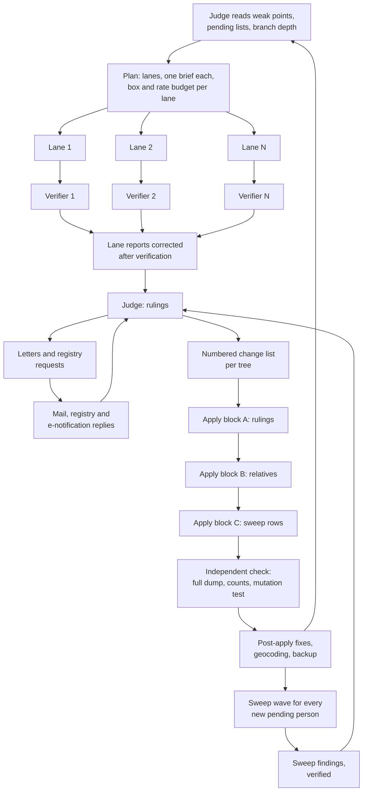

# The research pipeline

This is how we run AI agents against a family tree in Gramps Web without letting them write guesses into it. It has run 30 rounds over two trees of about 10,000 people each. The design is the part worth copying. The scripts in this repo are the pieces of it that were worth generalizing.

In short, agents research in parallel and never touch the tree. A second agent checks each finding against its source. A judge decides what is true. Only then does a writer apply the judge's rulings to the tree, in blocks, with a backup before each block and an independent check after it. Then every new person gets a broad search sweep, and the sweep's findings feed the next round.

## Roles

| Role | Reads | Writes | Never does |
|---|---|---|---|
| Planner / judge | Everything: prior rulings, lane reports, verdicts, sweep files, waiting and cost registers | The plan, the rulings, the change lists' inputs | Writes to the tree, contacts anyone |
| Research lane | Its brief, the rules file, all earlier rulings | One report file and the source files it downloaded | Commits, writes to the tree, contacts anyone, waits for an answer from main |
| Verifier (one per lane) | The lane's report and the sources it cites | A verdict file: each claim confirmed, corrected or refuted | Adds new research |
| Change-list writer | The rulings and the live tree | A numbered list of edits per tree | Decides anything the rulings did not decide |
| Applier | The change list | The tree, and an "applied" log with every Gramps id it touched | Skips the backup, invents data to fill a gap |
| Checker | A full dump of the tree after the apply | A verification report | Writes to the tree |
| Post-apply | The check's failures | Targeted fixes, geocoding, a final backup | Re-opens questions the judge settled |
| Sweep agent | One person at a time | One file per person with every source tried | Writes to the tree, contacts anyone |

Every lane ends its brief the same way: decide on your own, write down what you decided and why, and move on. A lane that waits for an answer stalls the round.

## Confidence levels

Every claim carries one of four levels, and the reason for it.

| Level | Meaning | Where it goes in the tree |
|---|---|---|
| **verified** | The record was opened at its source (the image, not only an index line) and it names this person: same place, same spouse or parents, age that fits | Event or relationship, citation confidence 3 or 4, the image attached |
| **probable** | Strong but not closed: one link is a deduction, or only an index line was seen | Event marked "probable", citation confidence 2, the reason in a note |
| **lead** | Worth following, not worth stating: a surname in the right village, a family tree someone else built, a DNA match | A research note only, citation confidence 0 or 1 if cited at all |
| **homonym** | Checked and it is someone else | Never as a finding. Written down so the next lane does not chase it again |

A homonym is never a finding. The cheapest way to ruin a tree is to attach a person with the right name from the wrong parish.

## "Corrected after verification"

A verifier does not write its own report. It returns a verdict per claim, and the lane's report is then corrected in place. Each changed sentence says so: *Corrected after the verification of round 27 (2026-10-19).* What the verifier refuted is struck out or removed. This keeps one report per lane that the judge can trust, and a visible trail of what changed. Without it, the judge reads two files that disagree and has to pick.

Typical refutations are small and matter: a month read wrong by the machine reading ("February" where the image says "January"), a ditto mark (`id.`) that repeats the month on the line above rather than the one you assumed, a sum copied from the wrong line, an image number mistaken for an amount.

## The ruling-to-apply contract

The judge's rulings are the only input to the tree. The change-list writer turns them into a numbered list, one per tree, and the applier executes that list and nothing else. The list must carry:

- **Each edit with its target.** Person, family, event, citation or note, by Gramps id. A new object gets a key in the list, and the applied log maps each key to the id Gramps gave it.
- **The citation for every fact.** A URL or a repo path, and the media file if the source is an image or a PDF.
- **"Before" paragraphs.** When a ruling overturns something already in the tree, the old value is kept in the note as *Before (round 26): …*. Nothing already written disappears without a trace.
- **What does not go in.** The judge lists the tempting wrong values explicitly ("not 1641", "not this surname"). The checker greps the new text for them.
- **Expected counts.** People, families, the Ahnentafel numbers that must exist after the apply and the ones that must not. A count that does not come out is reported with the reason, never adjusted to fit.
- **The standing approval, quoted.** The writers get the literal line from the rules file that authorizes the apply. See the harness trap in [hard-won.md](hard-won.md).

## Apply in blocks

Each round applies in three blocks, in one pass, per tree:

- **A:** the rulings themselves: new generations, life events, corrections, notes.
- **B:** the siblings, spouses and side relatives those rulings bring in.
- **C:** the sweep's findings, one change-list row per judged sweep row (new person, new event, or note only), with its exact row count.

Rules that hold for every block:

1. **Backup before and after each block.** A full `.gramps` export, stored off the box.
2. **Search the live tree by name before creating anyone.** Earlier rounds and earlier rows already created many of them. Add the new facts to the existing person.
3. **Life events go in when the source gives them**: occupation, residence, military service, emigration, will, property.
4. **Places are created with their full hierarchy** (parish or street, municipality, province, country). Only places that an event uses get coordinates. Containers stay blank, so the map shows one marker per event.
5. **The round is not done until block C is done.** The applied log is written only then.

## The independent check

A separate agent, not the applier, verifies. [`gwt-check`](check.md) runs the mechanical part of this list as one command; reading a sample against its rulings stays with the agent:

- A full dump of every object type (`GET /api/<type>/?pagesize=100000&backlinks=1`) at the start and at the end. Both must agree, and the last change time must match the last applied item.
- The expected counts and the Ahnentafel from the change list.
- Events with no place, places used by events with no coordinates: zero or explained.
- No media object that is text, JSON or a screenshot of someone else's viewer.
- None of the forbidden values in new text.
- Repeated vital events: same object, same type, same date.
- **That the check can fail.** Put five known errors into a copy of the dump and confirm the same script reports them. A check that has never gone red proves nothing.

Then a post-apply pass fixes what the check found, runs geocoding on the tree, and takes the final backup.

## Sweep waves

When a round's apply finishes, every person still marked "pending" in the sweep state table gets a sweep wave, highest priority first (direct ancestors and their siblings, then everyone else). Nobody has to ask for it. A sweep agent searches one person broadly: newspapers, official bulletins, obituaries, cemeteries, land records, court cases, emigrant lists, other people's trees. It searches the person **by their own full name**, and again with the spouse's or parents' names, in a fixed list of large indexes, not only through their relatives. Before it writes "nothing", it opens every collection listed for that person's villages.

Each sweep file ends with a checklist (died without children, died abroad, emigrated branch, will and notarial records, conscription, court cases, edicts, by full name, village collections), each item marked *looked*, *not applicable* with the reason, or *pending*. A file with anything pending stays partial.

The sweep's findings are verified like a lane's, judged row by row, and enter the tree in block C of the next round.

## The search ledger and the cache

Two shared files keep parallel agents from paying twice:

- **The ledger** ([`ledger/`](https://github.com/GeiserX/gramps-web-toolkit/tree/main/ledger)): every agent checks it before a search and appends after, negatives included. A negative leaves nothing in the tree, so without the ledger nobody knows it was done.
- **The cache** ([`fscache/`](https://github.com/GeiserX/gramps-web-toolkit/tree/main/fscache)): every good API answer is kept on disk. A repeated request costs no network call and no rate budget. Errors and blocks are never cached.

## Rate-limit gates

Every lane that touches a rate-limited site goes through one shared gate ([`gate/`](https://github.com/GeiserX/gramps-web-toolkit/tree/main/gate), [gwt-gate](gate.md)):

- `wait <lane>` before **every** request: page, search or image. The gate hands out one common pace across all lanes, not one per lane.
- `hit <lane> <what>` on any 429, 403, captcha or security notice. That pauses every lane and slows the pace.
- A hard block parks the gate for a day. `wait` then exits with a distinct code and the lane carries on with its other sources.
- A per-day budget per lane is written into its brief.
- No bulk harvesting of catalogs or whole films.
- A "no result" from a site that was blocking at the time is not a negative. It goes back on the list.

The ceiling is lower than you think. See the first entries in [hard-won.md](hard-won.md).

## Box spreading

We run three remote, headed Chrome instances on boxes with different public IP addresses. None of them belongs to a tree or a lane. For each source:

- Start on the box with the most free slots (count open pages over CDP first; each box has a ceiling).
- If the site blocks, throttles, asks for a captcha or is slow from that IP, try the other two before giving up.
- Write in the lane's report which IP worked for which source, so the next lane starts there.
- Each lane opens its own `connectOverCDP` connection and its own `newContext()`. Never `contexts()[0]`: that is the shared persistent profile.
- At most two contexts per lane. Every process dies with the lane.
- A step only a person can pass (captcha, certificate picker) goes to a browser on the owner's own screen, left at that step, not to a remote desktop.

## The mail, registry and e-notification loop

Archives, parishes and civil registries are most of where the old records are. The loop:

1. **Requests go out in writing, from us.** Email, web form, or the registry's online office. Never a list of phone calls for a relative.
2. **Never offer money or a visit** in the request. Ask for the record, free and by post or email.
3. **Every reply becomes an action in the same pass.** Do what they ask (their form, another address, another office), find the alternative if they say no (another archive, another series, the online index they mention), or open a search on what they mention. "Filed for next round" is not an action if the thing can be done now for free.
4. **Two registers are kept current by whoever sends or receives:** *waiting* (who we wait on, the last action, when to look again) and *costs money* (who charges, how much, for what; the default decision is to wait, since most things get digitized). Every dated row goes into a calendar.
5. **Requests that need the requester's ID certificate** (Spain's civil registry online office, DICIREG) are filed from the machine where the certificate lives. Spacing rules apply. See [hard-won.md](hard-won.md).
6. **Every mail pass also opens the government e-notification inbox** (DEHú in Spain) for each requester. Some registries answer only there.
7. **What can only be done in person** goes to an in-person task list with every known detail, and is not chased by mail.

## The next round

The judge starts the next round by reading:

- the weak-points table (facts held by a single index line, guesses, open conflicts);
- the heirs table, when new people came in;
- the waiting and costs-money registers;
- the sweep state table, to make sure no earlier wave was skipped;
- how far back each branch of each tree reaches.

Branches that reach the fewest generations get more lanes. Each round also has fixed lanes: property and wills per tree, missing civil death records for direct ancestors, and a coverage lane per tree that works the empty cells of the source-coverage table.
